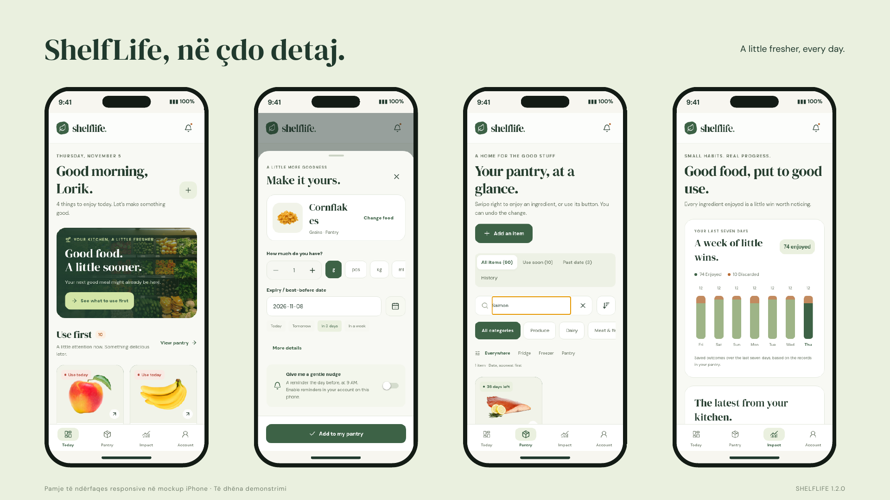
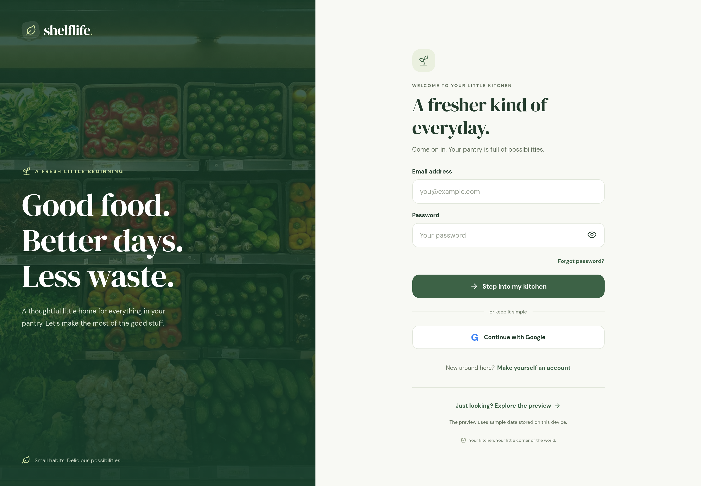
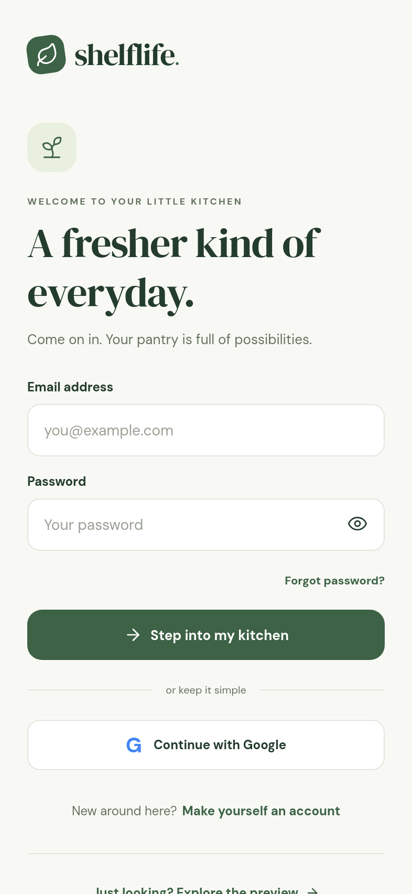

<p align="center">
  
</p>

<h1 align="center">ShelfLife</h1>
<p align="center"><strong>A little fresher, every day.</strong><br />A personal pantry companion built with React Native, JavaScript, Expo and Firebase.</p>

<p align="center">
  <a href="https://shelflife-6be50b4a.web.app">Open the web app</a> ·
  <a href="https://github.com/L0rikKelmendi/ShelfLife/releases/tag/v1.2.0">Download Android 1.2.0</a> ·
  <a href="docs/SETUP.md">Setup guide</a>
</p>

ShelfLife brings ingredients, expiry dates and everyday decisions into one place. See what needs attention, add food with pictured suggestions, receive a local reminder, and keep track of what you enjoyed or discarded.



*Responsive mobile previews in iPhone mockups, with synthetic demonstration data.*

## Features

- **Personal overview:** a daily greeting, ingredients due today and a prioritized “Use first” shelf.
- **Quick add:** 330 pictured food suggestions, recent and popular picks, custom names and editable quantity, storage and dates.
- **Pantry management:** search, category and storage filters, sorting, editing, confirmed deletion and history.
- **Swipe and Undo:** mark food as enjoyed with a swipe or button, then undo the change within seven seconds.
- **Local reminders:** optional reminders at 09:00 the day before an ingredient’s date, a test reminder and notification settings.
- **Weekly activity:** a seven-day outcome chart, recent activity and the proportion of completed items marked as enjoyed.
- **Accounts:** Firebase Email/Password, Google sign-in, password reset and separate data for each user.

Shared demonstration account: **`test@test.com` / `test123`**. It is preloaded with **450 synthetic records** representing one month: 90 active, 320 enjoyed and 40 discarded.

## Sign in your way

Sign in with **Email/Password** or choose **Continue with Google**. New users can create an account, and existing users can request a password reset from the login screen.



<details>
  <summary>Mobile login preview</summary>
  <p align="center"></p>
</details>

Google authentication uses **Firebase Authentication**: a Google popup in the browser, or a native Google ID token exchanged for a Firebase credential in a development build or standalone app. Native Google sign-in requires the matching OAuth configuration and is unavailable in Expo Go. See the [Google sign-in setup](docs/SETUP.md#native-google-sign-in).

## Install or run

Open **[ShelfLife online](https://shelflife-6be50b4a.web.app)** on a phone or laptop. The hosted version uses the same Firebase accounts and pantry data. Local device reminders require the mobile app.

Download the APK from the [1.2.0 release](https://github.com/L0rikKelmendi/ShelfLife/releases/tag/v1.2.0) and install it on Android. It can update the existing 1.1.0 installation. An APK cannot be installed on iPhone.

For development, use **Node 24.12+ within 24.x**:

```bash
git clone https://github.com/L0rikKelmendi/ShelfLife.git
cd ShelfLife
npm ci
cp .env.example .env.local
# Fill in your own Firebase configuration in .env.local.
npm start
```

Use `npm run web` for the browser or `npm run dev` for a native development build. A separate local preview is available without Firebase configuration. See [setup](docs/SETUP.md) for providers, rules, native builds and environment variables.

## Architecture

| Layer | Responsibility |
| --- | --- |
| `src/app/` | Expo Router screens and authenticated navigation |
| `src/components/` | Shared UI, forms, food suggestions, swipe actions and charts |
| `src/context/` | Authentication, pantry state, quick add and feedback |
| `src/services/` | Firebase, Firestore CRUD, Google sign-in and local notifications |
| `src/lib/` | Validation, food catalog, dates, filtering and activity calculations |
| `tests/` | Component, domain, service and database rules tests |

Firestore stores items at `users/{uid}/items/{itemId}`. Security rules restrict access to the owner and validate writes. `onSnapshot` keeps the pantry current. `FlatList`, `useMemo`, `useCallback` and `memo` support list performance; listeners are removed on cleanup. Transitions respect the system’s Reduce Motion preference.

## Testing

```bash
npm run check             # ESLint, JavaScript compiler check and Jest
npm run test:rules        # Firestore authorization and schema tests
npm run test:emulator-ui  # Isolated Firebase SDK browser journey
npm run export:web        # Production web export
```

The release passed **38 tests across 11 Jest suites**, one stored snapshot and **21/21 Expo Doctor checks**. Browser journeys covered authentication, CRUD, persistence, search, swipe and Undo at phone and desktop widths. [Testing notes](docs/TESTING.md) explain the checks and device verification boundaries.

## Project

Developed by **Lorik Kelmendi** for **Programimi për pajisje mobile — Semestri V**.

Interface: React Native 0.86, React 19 and Expo SDK 57. Backend: Firebase Authentication and Cloud Firestore. Testing: Jest, React Native Testing Library and Firebase emulators. [Asset credits](docs/ASSET-CREDITS.md) list image, icon and font sources. The [MIT license](LICENSE) covers the application code; third-party assets retain their own terms.

## Course requirements

| Requirement | Implementation |
| --- | --- |
| React Native with JavaScript and Expo | JavaScript/JSX application using Expo SDK 57 |
| At least three functional screens | Overview, Pantry, Add/Edit, Impact and Account, plus Login/Register |
| Firebase Email/Password and another provider | Email/Password and Google sign-in |
| Firebase CRUD | Create, realtime read, update and delete with Cloud Firestore |
| One device feature | Local notifications with `expo-notifications` |
| Performance optimization | `FlatList`, `useMemo`, `useCallback` and `memo` |
| Snapshot test | `tests/ItemCard.test.jsx` and its stored snapshot |
| Interaction test | `tests/ItemForm.test.jsx` |
| Mocking test | `tests/pantry.test.js` |
| Organized UI and clear structure | Shared theme/components with separate routes, context, services and domain helpers |
